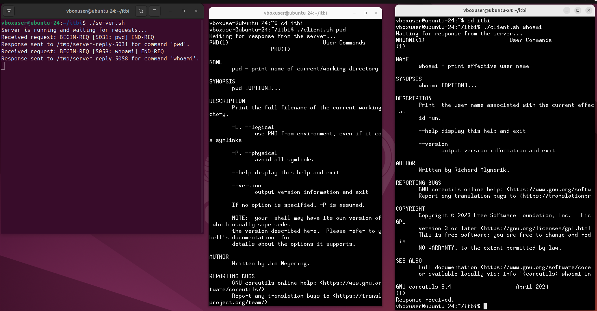
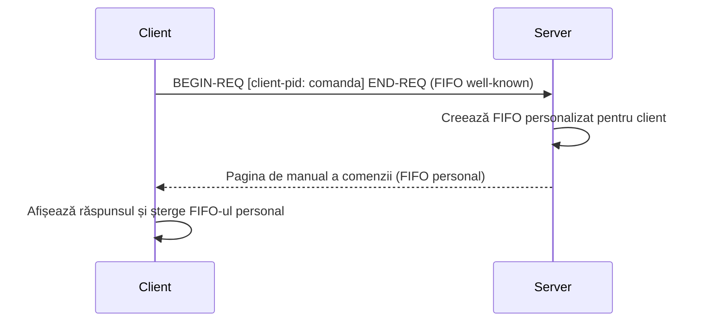

<h1 align="center">FIFO-SERVER</h1>

<p align="center">
  Sistem client–server în Bash care folosește FIFO-uri (named pipes) pentru comunicarea între procese.
</p>

<p align="center">
  
  
  
  
</p>

<p align="center">
  
</p>

## Despre proiect
FIFO-SERVER este un proiect realizat în cadrul cursului ITBI, care demonstrează comunicarea între procese (IPC) folosind exclusiv Bash și named pipes. Un server rulează continuu și primește cereri de la clienți. Pentru fiecare cerere, returnează pagina de manual (`man`) a comenzii cerute, printr-un canal dedicat clientului respectiv.

## Cum funcționează



1. Serverul ascultă pe un **FIFO well-known**, al cărui nume este configurabil.
2. Clientul trimite o cerere în formatul `BEGIN-REQ [client-pid: command-name] END-REQ`.
3. Serverul creează un **FIFO personalizat** pentru acel client, pe baza PID-ului.
4. Serverul scrie în el pagina de manual a comenzii cerute.
5. Clientul afișează răspunsul și **șterge FIFO-ul personal**.

## Funcționalități
- Comunicare client–server prin **named pipes**, fără sockets sau biblioteci externe
- **FIFO well-known configurabil**, citit dintr-un fișier de configurare
- **Canal de răspuns dedicat fiecărui client**, identificat prin PID
- Protocol simplu de cereri, delimitat cu `BEGIN-REQ` / `END-REQ`
- Verificări și mesaje de eroare clare (fișier de configurare lipsă, server oprit)
- Curățarea FIFO-ului personal după afișarea răspunsului

## Demo

| Server | Clienți |
|:---:|:---:|
| Primește cererile și trimite răspunsurile | Cer manualul pentru `pwd` și `whoami` |

<p align="center">
  
</p>

## Structura proiectului
```
FIFO-SERVER/
├── server.sh    # Serverul: ascultă cereri și trimite răspunsuri
├── client.sh    # Clientul: trimite cererea și afișează răspunsul
└── README.md
```

## Cum rulezi proiectul
```bash
git clone https://github.com/daria-stamin/FIFO-SERVER.git
cd FIFO-SERVER
chmod +x server.sh client.sh

# Terminal 1 – pornește serverul
./server.sh

# Terminal 2 – cere pagina de manual a unei comenzi
./client.sh pwd
```

## Tehnologii și concepte
- **Limbaj:** Bash
- **Concepte:** IPC, named pipes (FIFO), PID-uri, protocol de cereri, redirectări I/O
- **Mediu:** Linux / Unix (testat pe Ubuntu 24)

## Ce am învățat
- Comunicarea între procese prin named pipes
- Proiectarea unui protocol simplu client–server
- Gestionarea resurselor temporare (creare și ștergere de FIFO-uri)
- Scrierea de scripturi Bash cu verificări și tratarea erorilor

## Contact
**Daria Stamin** · [LinkedIn](https://linkedin.com/in/...) · email@exemplu.com
